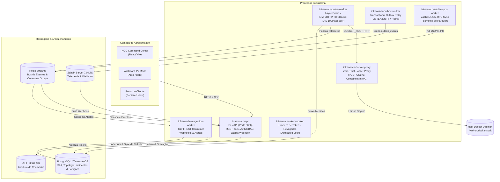

# InfraWatch 🛰️

> **Plataforma Enterprise de Observabilidade de Rede, NOC Telemetry & Gestão Automatizada de Incidentes com GLPI**

[](LICENSE)
[](https://fastapi.tiangolo.com)
[](https://react.dev)
[](https://www.typescriptlang.org)
[](https://www.postgresql.org)
[](https://redis.io)
[](https://glpi-project.org)

---

## 📌 Visão Geral

O **InfraWatch** é uma solução completa de observabilidade e monitoramento de infraestrutura de missão crítica, desenhada para atender provedores de telecomunicações, operadoras e empresas com infraestruturas distribuídas (como RCS Angola e Exija Serviços).

Diferente de ferramentas de monitoramento genéricas ou painéis estáticos, o InfraWatch implementa uma arquitetura orientada a eventos (*Event-Driven Architecture*) com desacoplamento rigoroso entre a coleta de métricas, o processamento de regras/alarmes e a apresentação em tempo real para múltiplos perfis de usuários.

---

## 🏛️ Arquitetura e Decisões de Engenharia

O sistema é construído como um monólito modular orientado a domínio (DDD) subdividido em serviços desacoplados que compartilham o mesmo repositório e infraestrutura de mensageria:



### Principais Pilares Arquiteturais
1. **Desacoplamento por Processos (ADR-001):** A API HTTP não executa coletas pesadas de rede; todo o probing assíncrono reside no `infrawatch-probe-worker`.
2. **Eliminação de BackgroundTasks em Favor de Consumers (ADR-003, ADR-020):** `background_tasks.add_task` foi eliminado para evitar vazamentos de sessão assíncrona (`AsyncSession`). Todas as integrações externas e notificações operam via *Consumers* no Redis Streams com DLQ (*Dead-Letter Queue*).
3. **Resiliência Transacional com Outbox Pattern (ADR-009, ADR-010):** Nenhuma sincronização com sistemas externos bloqueia o fluxo operacional da API. Eventos são persistidos atomicamente em banco e processados pelo worker com política de retentativa exponencial e acordados em <5ms via `LISTEN/NOTIFY` no PostgreSQL.
4. **Isolamento Multitenant Rigoroso com Papel `CLIENT_VIEWER` (ADR-012):** Clientes corporativos visualizam exclusivamente métricas e SLAs de seus próprios equipamentos através de uma visão sanitizada (sem exposição de IPs de gerência interna ou topologias reservadas).
5. **Janelas de Manutenção & Isenção de SLA (ADR-011):** Períodos de manutenção programada silenciam alarmes sonoros e são isentos do cômputo de penalização nos relatórios de SLA contratuais.
6. **Hardening de Segurança (ADR-021 a ADR-025):**
   - *Dual-Key Rate Limiting* (IP + E-mail) para mitigar ataques de força bruta distribuídos.
   - Respostas de login com tempo constante neutro (~10ms) para neutralizar ataques de temporização e enumeração de usuários.
   - Validação de *Trusted Proxies* no reverse proxy / Uvicorn.
   - Endpoint `/metrics` do Prometheus protegido por credenciais dedicadas de observabilidade.
7. **Monitoramento de Containers com Zero-Trust Socket Proxy (ADR-026):** Coleta nativa assíncrona de CPU cgroups, memória efetiva, throttling, restarts sucessivos e healthcheck da imagem via `infrawatch-docker-proxy` (`tecnativa/docker-socket-proxy`), bloqueando categoricamente chamadas de mutação (`POST=0`, `DELETE=0`, `PUT=0`, `EXEC=0`) e permitindo ao worker executar como usuário não-privilegiado `appuser` (UID 1000).
8. **Gerenciamento de Segredos com Docker Secrets (ADR-027):** Credenciais montadas em memória RAM tmpfs (`/run/secrets/`) com arquivos restritos (`chmod 600`), sem exposição em texto puro em `.env`, `docker inspect` ou `/proc/environ`.
9. **Ingestão Híbrida Zabbix Push/Pull e Bootstrapper Idempotente (ADR-028):** Recepção push instantânea de alarmes via webhook (`/api/v1/integrations/zabbix/webhook`) somada a pull periódico via JSON-RPC, com auto-provisionamento idempotente no startup (`ZabbixWebhookBootstrapper`).
10. **Thin Controllers, Unit of Work e Coesão Modular (ADR-029):** Rotas HTTP finas delegando orquestração a Handlers e Services desacoplados sob o pacote coeso `src.core.web`.
11. **Padronização Universal com TIMESTAMPTZ (ADR-030):** Todas as colunas temporais convertidas para UTC com timezone garantindo precisão milimétrica de SLA e compatibilidade universal SQLite/PostgreSQL.

---

## ⚡ Funcionalidades Principais

- 📡 **Micro-Probes Assíncronos & Alta Concorrência:** Sondas ICMP (Ping), HTTP/HTTPS (Status, Latência, TLS), TCP Port (Portas de banco e serviços) e DNS com controle de jitter, tolerância a flapping e limiares dinâmicos de degradação (*Degraded State*).
- 🐳 **Monitoramento Nativo de Containers Docker (ADR-026):** Coleta direta via Docker Engine API intermediada por proxy seguro Zero-Trust (`infrawatch-docker-proxy`), extraindo CPU real de cgroups, memória sem cache inativo, throttling, restarts sucessivos e healthcheck da imagem sem necessidade de root.
- ⚡ **Telemetria Híbrida Zabbix Push & Pull (ADR-028):** Recepção instantânea de alertas via Webhook push (`/api/v1/integrations/zabbix/webhook`) com autoconfiguração de MediaType/Action no startup somada à sincronização periódica de telemetria de hardware (CPU, RAM, Disco, Interfaces).
- 🎫 **Integração Bidirecional Nativa com GLPI:** Abertura automática de chamados para incidentes `CRITICAL`, rastreamento de IDs de tickets, sincronização periódica de status e encerramento com registro de downtime.
- 📊 **Cálculo de SLA em Tempo Real & Isenção de Manutenção:** Motor analítico com cálculo de MTBF, MTTR, disponibilidade percentual mensal (ex: 99.9%) e relatórios executivos com isenção contratual para janelas programadas.
- 🖥️ **Cockpit NOC & Modo TV:** Interface de alta densidade no padrão *Dark Slate*, gráficos de telemetria sem recarregamento via SSE (*Server-Sent Events*) e modo rotação automática para monitores de parede no centro de operações.
- 🏢 **Portal do Cliente Sanitizado:** Visão simplificada e transparente para clientes corporativos (`CLIENT_VIEWER`) consultarem a saúde de seus enlaces contratados com IPs internos e portas sensíveis mascarados.

---

## 📚 Documentação do Projeto

Toda a documentação técnica, contratos de API, especificações e planos de implementação estão organizados no diretório [`docs/`](docs/):

| Documento | Descrição |
| :--- | :--- |
| [ARCHITECTURE.MD](ARCHITECTURE.MD) | Arquitetura de software DDD, topologia de processos, barramento de eventos, ADRs e fluxos |
| [01-PRD.md](docs/01-PRD.md) | Documento de Requisitos de Produto (Escopo, Personas, SLAs, Métricas) |
| [02-TRD.md](docs/02-TRD.md) | Especificação Técnica (Contratos de API, Integração GLPI/Zabbix, Redis Streams, SSE) |
| [03-APP_FLOW.md](docs/03-APP_FLOW.md) | Fluxos de Aplicação (NOC, Triagem de Incidentes, Manutenção, Portal do Cliente, Push Zabbix) |
| [04-UI_UX_BRIEF.md](docs/04-UI_UX_BRIEF.md) | Especificação de Design System (Paleta Obsidian, Tipografia, Componentes) |
| [05-BACKEND_SCHEMA.md](docs/05-BACKEND_SCHEMA.md) | DDL Completo do Banco de Dados, Índices, Constraints, TIMESTAMPTZ e Particionamento |
| [06-IMPLEMENTATION_PLAN.md](docs/06-IMPLEMENTATION_PLAN.md) | Plano Detalhado de Implementação em 6 Fases com Status de Entrega Atualizado |
| [DECISIONS.md](docs/DECISIONS.md) | Registro de Decisões de Arquitetura (ADR-001 a ADR-030) |

---

## 🛠️ Stack Tecnológica

### Backend & Workers
- **Linguagem & Framework:** Python 3.12+, FastAPI
- **ORM & Banco de Dados:** SQLAlchemy 2.0 (AsyncIO), PostgreSQL 16 com partições de séries temporais e TIMESTAMPTZ
- **Mensageria & Cache:** Redis 7.2+ (Streams, Consumer Groups, Distributed Locks)
- **Segurança & Credenciais:** Docker Secrets (`/run/secrets/`), Argon2id, PyJWT, SecretStr

### Frontend
- **Framework & Ferramentas:** React 18, TypeScript 5.5, Vite
- **Gerenciamento de Estado & Consultas:** TanStack Query (React Query) + Zustand
- **Estilização & Componentes:** TailwindCSS / CSS puro calibrado no padrão Obsidian Telemetry
- **Visualização de Dados:** Lucide React, Recharts / ECharts

### Infraestrutura & DevOps
- Docker & Docker Compose com Docker Secrets e Docker Socket Proxy
- Prometheus & Grafana para telemetria de produção
- GitHub Actions para CI/CD automatizado

---

## 🚀 Como Executar Localmente

### Pré-requisitos
- Docker & Docker Compose
- Python 3.12+ (uv ou poetry recomendado)
- Node.js 20+ e pnpm / npm

### Passo a Passo

1. **Clonar o repositório:**
   ```bash
   git clone https://github.com/NdondaDaniel2020/InfraWatch.git
   cd InfraWatch
   ```

2. **Inicializar os Segredos Seguros (Docker Secrets):**
   ```bash
   chmod +x scripts/init-secrets.sh
   ./scripts/init-secrets.sh
   # Gera automaticamente os arquivos em secrets/*.txt com permissões restritas (chmod 600)
   ```

3. **Iniciar a infraestrutura auxiliar (PostgreSQL + Redis + Socket Proxy):**
   ```bash
   docker compose up -d postgres redis infrawatch-docker-proxy
   ```

4. **Executar as migrações de banco:**
   ```bash
   cd backend
   alembic upgrade head
   ```

5. **Iniciar os serviços e workers assíncronos:**
   ```bash
   # Terminal 1: API REST, SSE & Zabbix Webhook
   uvicorn src.main:app --host 0.0.0.0 --port 8000 --reload

   # Terminal 2: Probe Worker (Sondas ICMP, HTTP, TCP e Docker)
   python -m src.workers.daemons.probe_worker

   # Terminal 3: Integration Worker (GLPI & Notificações)
   python -m src.workers.daemons.integration_worker

   # Terminal 4: Zabbix Sync Worker (Telemetria periódica de Hardware)
   python -m src.workers.daemons.zabbix_sync_worker

   # Terminal 5: Outbox Relay Worker (Despacho transacional de eventos para Redis Streams)
   python -m src.workers.daemons.outbox_relay_worker

   # Terminal 6: Token Cleanup Worker (Expurgo de sessões revogadas com Distributed Lock)
   python -m src.workers.daemons.token_cleanup_worker
   ```

### 🧪 Ambientes de Teste de Integração (GLPI & Zabbix)

O InfraWatch disponibiliza stacks completas em Docker Compose e scripts automatizados para validar as integrações de ponta a ponta:

```bash
# --- Integração Zabbix 7.0 LTS (Porta Web: 8081 / API: /api_jsonrpc.php) ---
make zabbix-up      # Sobe Zabbix DB, Server, Web Nginx e Agent
make test-zabbix    # Executa validação de API, login, hosts e telemetria
make zabbix-down    # Para os containers do Zabbix

# --- Integração GLPI 10+ (Porta Web: 8080 / API: /apirest.php) ---
make glpi-up        # Sobe MariaDB e GLPI App
make test-glpi      # Executa validação de autenticação, abertura e acompanhamento
make glpi-down      # Para os containers do GLPI
```


## 📄 Licença

Este projeto está sob a licença [MIT](LICENSE). Consulte o arquivo de licença para mais detalhes.
