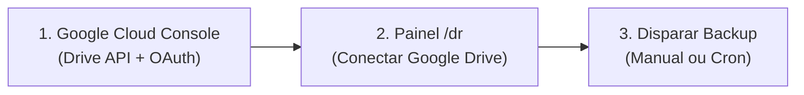

# InfraWatch — Guia Definitivo: Configuração e Execução de Backups (Local & Cloud)

> **Documento:** `docs/GUIA_CONFIGURACAO_E_EXECUCAO_BACKUP.md`  
> **Público-alvo:** Operadores NOC, DevOps, SysAdmins e Desenvolvedores  
> **Arquitetura Base:** ADR-032 / Zero Blast Radius Backup Pipeline  
> **Última Atualização:** Novembro de 2026

---

## 🎯 Objetivo

Este guia prático ensina o passo a passo exato para **configurar do zero**, **autorizar** e **executar** backups automáticos e manuais no InfraWatch, com replicação simultânea:
1. **Armazenamento Local:** Cópia compactada `.tar.gz` com checksum imutável SHA-256 e cifra AES-256 de segredos.
2. **Google Drive:** Replicação offsite primária via Rclone com autorização OAuth 2.0 dinâmica.
3. **Cloudflare R2 (Opcional):** Replicação secundária geodistribuída S3-compatível (zero egress).

---

## 📋 Sumário Executivo: "O que preciso fazer?"

Para colocar os backups para funcionar, são necessários apenas **3 passos**:



1. **Configurar o Google Cloud Console** (Credenciais OAuth, Utilizadores de Teste e ativar a Google Drive API).
2. **Conectar o Google Drive na interface Web** (Clicar em *"Conectar Google Drive"* na rota `/dr`).
3. **Executar o Backup** (Pelo painel Web `/dr`, via CLI `make backup`, ou aguardar o agendamento diário às 02:00 UTC).

---

## 🛠️ Passo 1: Preparação no Google Cloud Console (GCP)

> [!IMPORTANT]
> O Google Drive exige autorização OAuth 2.0. As etapas abaixo são executadas **uma única vez** no [Google Cloud Console](https://console.cloud.google.com/).

### 1.1. Ativar a Google Drive API no Projeto GCP
1. Aceda ao link direto de ativação da biblioteca:
   👉 **[Ativar Google Drive API no GCP](https://console.developers.google.com/apis/api/drive.googleapis.com/overview)**
2. Certifique-se de que o projeto ativo é o do InfraWatch (ex.: ID `208111901620`).
3. Clique no botão azul **"ATIVAR"** (*ENABLE*).
   *(Se a API não for ativada, o Google rejeitará o envio com `Erro 403: SERVICE_DISABLED`).*

### 1.2. Configurar o Ecrã de Consentimento OAuth (*OAuth Consent Screen*)
1. No menu lateral: **APIs e Serviços** ➔ **Ecrã de consentimento OAuth** (*OAuth consent screen*).
2. Tipo de utilizador: **Externo** (*External*).
3. Preencha o nome da app (ex.: `InfraWatch NOC`) e o seu e-mail de suporte.
4. **Utilizadores de Teste (*Test users*) — MANDATÓRIO:**
   * Enquanto a app estiver com estado de publicação em **"Teste"** (*Testing*), role até à secção **"Utilizadores de teste"**.
   * Clique em **`+ ADICIONAR UTILIZADORES`** (*+ ADD USERS*).
   * Insira o e-mail Google que você usará para armazenar os backups (ex.: `ndondadaniel2020@gmail.com`).
   * Clique em **Guardar** (*Save*).
   *(Se o e-mail não estiver aqui, o Google bloqueará a autorização com `Erro 403: access_denied`).*

### 1.3. Configurar as Credenciais OAuth 2.0 (Web Client)
1. No menu lateral: **APIs e Serviços** ➔ **Credenciais** (*Credentials*).
2. Clique em **`+ CRIAR CREDENCIAIS`** ➔ **ID do cliente OAuth** (*OAuth client ID*).
3. Tipo de aplicação: **Aplicação Web** (*Web application*).
4. **Origens JavaScript autorizadas:**
   ```text
   https://infrawatch.42.fr
   https://localhost
   http://localhost:3000
   ```
5. **URIs de redirecionamento autorizados:**
   ```text
   https://infrawatch.42.fr/auth/callback
   https://localhost/auth/callback
   http://localhost:3000/auth/callback
   ```
6. Clique em **Criar** (*Create*) e guarde o `Client ID` e o `Client Secret`.

### 1.4. Inserir Credenciais no InfraWatch
Insira as credenciais geradas nos Docker Secrets:
* `secrets/google_client_id.txt`
* `secrets/google_client_secret.txt`

*(Ou no arquivo `backend/.env.production` sob `GOOGLE_CLIENT_ID` e `GOOGLE_CLIENT_SECRET`).*

---

## 🔗 Passo 2: Conectar o Google Drive no Painel do InfraWatch

O InfraWatch possui autorização **Zero-Downtime** (não precisa reiniciar nenhum contêiner):

1. Abra o navegador e aceda ao painel de Disaster Recovery:
   👉 **`https://infrawatch.42.fr/dr`** *(ou `https://localhost/dr`)*
2. Faça login com um utilizador administrador (ex.: `noc-admin@rcsangola.co.ao`).
3. No topo da página de DR, localize o crachá ou banner do Google Drive e clique em:
   👉 **"Conectar Google Drive"** *(ou "Reconectar")*.
4. Você será redirecionado para o Google:
   * Selecione a conta de teste cadastrada (`ndondadaniel2020@gmail.com`).
   * Se aparecer *"A Google não validou esta app"*, clique em **Avançadas** ➔ **Aceder a 42.fr (não seguro)**.
   * Conceda a permissão de visualização e gestão de arquivos no Google Drive.
5. O Google redirecionará de volta para o InfraWatch:
   * O backend processa o `refresh_token` automaticamente.
   * O Redis Pub/Sub notifica o daemon `infrawatch-backup` em tempo de execução via canal `backup:config_update`.
   * O crachá exibirá: **`Google Drive Conectado (✓)`** em verde!

---

## 🚀 Passo 3: Como Executar os Backups

### Método 1: Pela Interface Web (Recomendado no dia a dia)
1. Em `https://infrawatch.42.fr/dr`, clique no botão **"Disparar Backup Manual"**.
2. Digite uma justificativa/nota operacional (ex.: *"Backup pré-deploy de versão"*).
3. Clique em **"Iniciar Processo"**.
4. O modal em tempo real exibirá o progresso através de Server-Sent Events (SSE):
   * `[20%]` Dump do TimescaleDB e Hypertables
   * `[40%]` Snapshot do Redis
   * `[55%]` Cifragem AES-256 PBKDF2 dos segredos
   * `[70%]` Empacotamento `.tar.gz` e cálculo SHA-256
   * `[85%]` Envio para Google Drive via Rclone
   * `[93%]` Envio para Cloudflare R2 (se configurado)
   * `[95%]` Limpeza e aplicação da política de retenção local
   * `[100%]` Conclusão do Backup
5. Clique em **"Concluir e Fechar"**. A tabela será atualizada instantaneamente com o novo snapshot no topo.

### Método 2: Pela Linha de Comando (CLI / Makefile)
Útil para rotinas de manutenção ou automações de terminal:
```bash
# Executa a rotina dentro do contêiner dedicado infrawatch-backup
make backup
```
Ou disparando o evento via Redis CLI:
```bash
docker exec infrawatch-redis redis-cli publish backup:trigger '{"trigger":"manual","notes":"Disparo via CLI"}'
```

### Método 3: Rotina Automática Diária (Cron Agendado)
O contêiner `infrawatch-backup` possui um daemon interno que executa diariamente às **02:00 UTC** (`0 2 * * *`), aplicando a política de retenção de 7 dias local e 30 dias na nuvem.

### Método 4: Sincronização e Reconciliação Retroativa com a Nuvem
Caso existam backups locais antigos que foram gerados antes da autorização do Google Drive (ou snapshots pendentes de replicação), utilize o comando de sincronização em lote:
```bash
make sync-backups
```
*Este comando copia todos os bundles `.tar.gz` e checksums `.sha256` locais para a pasta `infrawatch-backups` do Google Drive e executa o script `scripts/reconcile_backup_metadata.sh`, atualizando instantaneamente os manifestos `.meta.json` para exibir `Local: SUCCESS` e `GDrive: SUCCESS` na tabela do dashboard.*

---

## 🔍 Passo 4: Como Comprovar que o Backup Realmente Funcionou

### 1. Conferir no Google Drive (via CLI ou Web)
No terminal do servidor:
```bash
docker exec infrawatch-backup rclone --config /tmp/rclone.conf ls gdrive:infrawatch-backups/
```
*Saída esperada:*
```text
      107 infrawatch_backup_YYYYMMDD_HHMMSS.tar.gz.sha256
 54532144 infrawatch_backup_YYYYMMDD_HHMMSS.tar.gz
```
Ou abrindo o Google Drive da conta no navegador: acesse a pasta `infrawatch-backups`.

### 2. Conferir no Armazenamento Local
```bash
ls -lh /var/backups/infrawatch/
```
*Deverá constar o arquivo compactado e seu manifesto `.meta.json` auditável.*

### 3. Conferir os Logs do Contêiner
```bash
docker logs --tail 50 infrawatch-backup
```
*No rodapé do log deverá exibir o sumário:*
```text
================================================================================
✅ *[InfraWatch]* Rotina de Backup Concluída!
📦 *Arquivo:* `infrawatch_backup_20261117_233613.tar.gz` (53M)
🔐 *SHA-256:* `bba4b5708c86a861...`
💾 *Local:* SUCCESS
☁️ *Google Drive:* SUCCESS
⚡ *Cloudflare R2:* SKIPPED
================================================================================
```

---

## 🚨 Guia de Resolução de Problemas (Troubleshooting)

| Erro Apresentado | Causa Raiz | Como Corrigir |
| :--- | :--- | :--- |
| **`Erro 400: redirect_uri_mismatch`** | A URL que o navegador enviou não está cadastrada no GCP. | Adicione `https://infrawatch.42.fr/auth/callback` nas **URIs de redirecionamento autorizados** no GCP. |
| **`Erro 403: access_denied`** | Projeto GCP em modo de teste e e-mail não aprovado. | No GCP, vá a **Ecrã de consentimento OAuth** ➔ **Utilizadores de teste** e adicione o seu e-mail Google. |
| **`Erro 403: SERVICE_DISABLED`** | A API do Drive está desativada no projeto GCP. | Abra [Google Drive API Overview](https://console.developers.google.com/apis/api/drive.googleapis.com/overview) e clique em **ATIVAR** (*ENABLE*). |
| **Cloudflare R2 com crachá vermelho** | R2 não configurado no `rclone.conf`. | O script agora marca como **Ignorado** (*SKIPPED*) automaticamente caso não configurado. Para ativar, insira as credenciais S3 em `secrets/rclone_config.txt`. |
| **Tabela no painel não atualiza após o modal** | Cache do navegador antigo. | Pressione `Ctrl + F5` para atualizar o frontend. O fechamento do modal agora força reconciliação automática. |

---

## 🔐 Entendendo Checksum SHA-256, Descompactação e Criptografia

Muitos operadores têm dúvidas sobre o papel de cada tecnologia no pipeline de backup. A tabela abaixo sintetiza a responsabilidade de cada camada:

| Componente | Ferramenta / Algoritmo | Papel no Sistema | Modifica os Dados? |
| :--- | :--- | :--- | :--- |
| **Checksum SHA-256** | `sha256sum` (Hash 256 bits) | **Verificação de Integridade Criptográfica**: Gera uma impressão digital imutável de 64 caracteres. Serve para conferir se nenhum bit foi corrompido durante transferência na rede ou falha de disco. | **Não**. Não descompacta nem altera arquivos. |
| **Descompactação** | `tar -xzf` (GNU Tar + Gzip) | **Extração de Arquivos**: Descompacta o arquivo `.tar.gz` contendo o dump do banco, snapshot do Redis e manifestos. | **Sim**, expande os bytes comprimidos. |
| **Cifra de Segredos** | OpenSSL `aes-256-cbc -pbkdf2` | **Proteção de Credenciais**: Cifra com 100.000 iterações e chave mestra os arquivos confidenciais (`secrets.tar.gz.enc`). | **Sim**, converte texto cifrado em arquivos legíveis. |
| **Restauração de BD** | `pg_restore` / TimescaleDB | **Injeção no Banco**: Recria tabelas relacionais, hypertables de telemetria e índices. | **Sim**, escreve os dados no banco de dados. |

---

## 🔄 Como Restaurar um Backup (Disaster Recovery)

> [!IMPORTANT]
> **Por que a restauração é feita via Terminal (CLI) e NÃO por botão na Web?**
> 1. **Zero Blast Radius e Prevenção de Catástrofes:** Uma restauração executa `pg_restore --clean`, que apaga dados existentes para restaurar o estado passado. Um botão na interface web exporia o sistema a cliques acidentais de operadores, podendo destruir dados em produção.
> 2. **Independência em Desastre Real:** Em caso de corrupção severa do banco ou queda do servidor web, a API e o painel Web estarão inacessíveis. O procedimento de DR deve funcionar de forma resiliente diretamente pelo terminal.

### 🧪 Modo Simulação (DR Dry-Run — Zero Risco ao Banco Ativo)
Você pode comprovar a qualquer momento que um backup está íntegro e decifrável **sem aplicar nenhuma alteração** no seu banco de dados em produção:

```bash
# Simula a restauração do backup mais recente
make restore DRY_RUN=1

# Ou simula a restauração de um arquivo específico
make restore FILE=infrawatch_backup_20261118_020000.tar.gz DRY_RUN=1
```
*O modo Dry-Run baixa o pacote, confere o hash SHA-256, descompacta em `/tmp`, decifra os segredos via OpenSSL e valida o catálogo do PostgreSQL com `pg_restore --list`, garantindo prontidão para desastre com 0% de risco.*

---

### 🚨 Restauração Efetiva em Produção (Disaster Recovery Drill)

#### Cenário A: Restaurar a partir do disco local
```bash
# Restaura o backup mais recente existente em /var/backups/infrawatch
make restore

# Ou restaura um snapshot específico
make restore FILE=infrawatch_backup_20261117_233613.tar.gz
```

#### Cenário B: Restaurar a partir do Google Drive (Perda total do host / Servidor novo)
Caso o host tenha sofrido perda de disco e precise baixar o snapshot da nuvem:
```bash
# Busca e restaura automaticamente o backup mais recente no Google Drive
make restore FROM=gdrive

# Ou baixa e restaura um arquivo específico da nuvem
make restore FILE=infrawatch_backup_20261117_233613.tar.gz FROM=gdrive
```
*O script utiliza as credenciais Rclone ativas, baixa o bundle e o `.sha256` correspondente, valida a integridade e restaura o TimescaleDB e o Redis.*

#### Cenário C: Restaurar a partir do Cloudflare R2
```bash
make restore FILE=infrawatch_backup_20261117_233613.tar.gz FROM=r2
```

---

## 💾 Persistência de Tokens Google Drive entre Reinícios

Para evitar que o operador precise reconectar o Google Drive toda vez que o servidor for reiniciado:
* As credenciais do Google Drive obtidas via OAuth 2.0 são gravadas em `/var/backups/infrawatch/.rclone.conf` dentro do volume Docker persistente `backup_data`.
* Na inicialização do contêiner `infrawatch-backup`, o arquivo é carregado automaticamente antes de ler segredos estáticos, mantendo a replicação em nuvem ativa permanentemente.

---

## 📋 Checklist de Validação Pós-Restauração

Após executar `make restore`, realize a verificação de sanidade operacional:

1. **Status dos Contêineres:**
   ```bash
   make status
   ```
   *Todos os contêineres principais devem estar `Up (healthy)`.*

2. **Saúde da API:**
   ```bash
   curl -s http://localhost:8000/api/health | jq .
   ```
   *Deverá retornar `{"status": "healthy"}`.*

3. **Validação das Hypertables do TimescaleDB:**
   ```bash
   docker exec infrawatch-postgres psql -U infrawatch_user -d infrawatch_db -c "SELECT count(*) FROM telemetry_metrics;"
   ```

4. **Acesso ao Cockpit Web:**
   Aceda a `https://infrawatch.42.fr/dr` e confirme a consistência dos dados operacionais e de telemetria.
